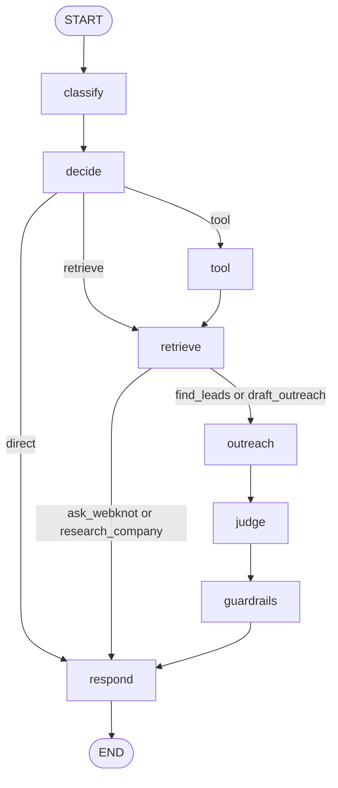

# Architecture — Webknot BD Agent

**Status:** Current architecture, 13 Nov 2026.  
**Sources:** [Decisions.md](Decisions.md) (D1–D18) and [PRD.md](PRD.md).  
**Code:** `src/webknot_bd/`.

A single Webknot operator types a target. A local LangGraph run classifies it, optionally searches public company signals, scores those companies against a local knowledge base, and drafts emails that stay `pending_approval` until the operator edits and approves or rejects them. The process ends in SQLite. Nothing is emailed.

## 1. Shape

One process on one machine. No login, no hosted service, no shared CRM.

```mermaid
flowchart LR
  operator[Operator]
  ui[Streamlit]
  graph[LangGraph]
  ollama[Ollama llama3]
  embed[Ollama nomic-embed-text]
  chroma[(Chroma)]
  tools[Public search and page fetch]
  crm[(SQLite CRM)]

  operator --> ui
  ui --> graph
  graph --> ollama
  graph --> chroma
  chroma --> embed
  graph --> tools
  graph --> crm
  ui --> crm
```

| Boundary | What crosses it |
| --- | --- |
| Operator → Streamlit | One query, then edits, approve, reject, or CSV export |
| Graph → Ollama chat | Structured classify, decide, search-brief, draft, and judge calls, and optional rerank. Only when the matching flag is on |
| Graph → Chroma | Similarity search over the seed corpus. Embeddings are `nomic-embed-text` |
| Graph → public web | Tavily when `TAVILY_API_KEY` is set, otherwise DuckDuckGo, plus one public page fetch per URL. Company, job, and news pages only |
| Graph and UI → SQLite | Lead rows, draft status, and the 90-day contact window |

Chat and embeddings are separate. `USE_LLM=false` keeps classify, decide, the search brief, the draft, and the judge on the deterministic baseline. Ingest and retrieval still call the embedding model when the store is used. If that call fails, retrieval returns an empty list and the route still completes.

## 2. Packages

```
src/webknot_bd/
  config.py            pydantic-settings. Paths, models, flags
  schemas/             Pydantic contracts between nodes
  graph/               StateGraph, router, LLM helper, nodes
  rag/                 Loaders, two chunkers, ingest, retriever, optional rerank
  tools/               Named tools with typed input and output
  memory/              Dedupe policy over the CRM
  ui/app.py            One Streamlit page
  evals/queries.py     The three rubric queries
scripts/ingest.py      Rebuild chroma/ from data/raw
data/raw/web/          Service pages and case studies
data/raw/docs/         ICP and other internal docs
data/crm.sqlite        Gitignored CRM
chroma/                Gitignored vector store
```

Nodes do not import each other’s internals. They read and write `GraphState`. Tool functions are reached by name through `tools/registry.py`. The CRM writer is also called directly from the outreach node and from the approval buttons.

## 3. Graph

Compiled in `graph/builder.py`. `run_query` starts from `{query, trace: []}` and returns `final_response`.



| Intent | Route | Path after `decide` |
| --- | --- | --- |
| `find_leads` | `tool` | tools → retrieve → outreach → judge → guardrails → respond |
| `research_company` | `tool` | tools → retrieve → respond |
| `draft_outreach` | `retrieve` | retrieve → outreach → judge → guardrails → respond |
| `ask_webknot` | `retrieve` | retrieve → respond |
| General advice such as a subject-line question | `direct` | respond |

The direct-advice check runs before the intent’s default route. A question that asks what makes a good cold email, how to write one, or for best practice, and that is not a find-leads or ask-Webknot request, goes straight to `respond`. “Draft an outreach email …” stays on `draft_outreach` and is grounded in the corpus.

Rubric routes, covered with the chat model off:

| Query | Intent | Route |
| --- | --- | --- |
| Which Webknot case study fits a logistics company? | `ask_webknot` | `retrieve` |
| Find 5 fintech startups hiring React developers in Bengaluru | `find_leads` | `tool`, then retrieve for fit |
| What makes a good cold email subject line? | `draft_outreach` | `direct` |

`classify`, `decide`, the find-leads search brief, draft writing, and the judge share one pattern: a deterministic baseline, and the same function signature for Ollama structured output.

When `USE_LLM=true`:

1. Call `llama3` at `http://127.0.0.1:11434` with temperature 0 and `with_structured_output`.
2. If validation fails, retry once.
3. If the retry fails, use the baseline and append a trace event that says the baseline was used.

`USE_LLM=false` skips the model and uses the baseline immediately. The baseline is keyword routing in `graph/router.py`, a slot reader for the search phrase, fixed draft text, and the judge's deterministic notes. It is the path tests execute.

A find-leads sentence is read into a `LeadRequest` before search is called. The model does not write the search phrase. Code builds it from the slots, in this order: sector, signal word, role, `remote` when set, location, then `jobs`, `funding`, or `product launch`. The rubric sentence still produces `fintech hiring React developers Bengaluru jobs`.

| Slot | Meaning |
| --- | --- |
| `count` | First integer, clamped to 1–10. Default 5 |
| `location` | Any place. `bangalore` is stored as Bengaluru |
| `remote` | True only when the sentence says remote, WFH, or work from home |
| `role` | Short skill phrase, such as `Java Spring Boot` or `React developers` |
| `sector` | Industry word, such as `fintech` |
| `signal` | `hiring`, `funding`, or `launch`. "Looking for", "devs", "developers", "engineers", and "open roles" count as hiring unless the sentence is about funding or a launch |

The offline reader covers those slots for the rubric sentence and for ordinary "in {place}" phrasing. With the model on, a reply is rejected when location or role is the whole sentence, when remote was not in the sentence, or when a hiring sentence comes back with another signal. The lead screen shows the slots that were searched.

## 4. State and contracts

`GraphState` is a `TypedDict`. `trace` is append-only (`operator.add`). Every other field is replaced by the node that owns it.

| Field | Written by | Contents |
| --- | --- | --- |
| `query` | caller | Operator text |
| `intent` | classify | `Intent` dump |
| `decision` | decide | `Decision` dump: `route`, `reason`, `confidence` |
| `tool_results` | tool | Named tool outputs |
| `leads` | tool, then outreach may replace after scoring | `LeadCard` dumps |
| `retrieved_chunks` | retrieve | Text plus metadata |
| `industry`, `service` | retrieve | Filters detected on the query |
| `drafts` | outreach, then guardrails replaces the bodies | `OutreachDraft` dumps |
| `trace` | every node | `TraceEvent` dumps |
| `final_response` | respond | `FinalResponse` dump |

Pydantic models in `schemas/` are the contract. Nodes dump to dicts on the state and validate again at the next boundary. Invalid payloads fail the node rather than being coerced.

| Model | Rules |
| --- | --- |
| `Intent` | One of `find_leads`, `research_company`, `draft_outreach`, `ask_webknot`. Confidence is 0–1. Rationale is required |
| `Decision` | One of `retrieve`, `tool`, `direct`. Reason and confidence are required |
| `LeadRequest` | `count` 1–10, `location`, `remote`, `role`, `sector`, `signal`. The search phrase is built from these fields |
| `LeadCard` | `company`, `signal` (`hiring`, `funding`, `launch`), `evidence_url` (http or https only), `fit_score` 0–100, `matched_service`, `reasoning` |
| `OutreachDraft` | `company`, `subject`, `body`, `personalization_hooks`, `case_study_used`, `status`. New drafts are `pending_approval` |
| `FinalResponse` | `answer`, `leads`, `drafts`, `trace`, `decision`, `intent` |
| Tool I/O | One input and one output model per tool. A live search or fetch sets `placeholder` to false. The offline test fixture sets it to true |

`matched_service` is exactly one of:

- product engineering
- dedicated squads
- MVP build
- React / frontend
- backend and APIs
- mobile
- AI / ML implementation

Staff augmentation is outside this list. The scorer picks one line. It does not invent another.

## 5. Knowledge base

The corpus is the seed files in `data/raw/` only: `docs/icp.md`, `web/services.md`, and `web/case_study_logistics.md`. Ingest does not crawl a site and does not wait on PDFs. Loaders still accept `.md`, `.txt`, and `.pdf` so a later real file can drop into the same folders.

`scripts/ingest.py` loads, chunks, deletes `chroma/`, and writes collection `webknot_knowledge`.

| Folder | `doc_type` | Splitter | Size / overlap | `chunk_strategy` |
| --- | --- | --- | --- | --- |
| `data/raw/web/` | `web` | `RecursiveCharacterTextSplitter` | 800 / 150 | `recursive` |
| `data/raw/docs/` | `doc` | `CharacterTextSplitter`, empty separator | 1000 / 0 | `fixed` |

Chunk metadata: `source`, `doc_type`, `industry`, `service`, `sample`, `chunk_strategy`. Front matter on the seed files supplies industry, service, and the sample flag.

Retrieval is Chroma similarity search, `TOP_K=4`, behind `rag/retriever.py`. A metadata filter is applied only when the query or the lead names an industry or a service. Known industries for detection are logistics, fintech, healthcare, ecommerce, and edtech. There is no standing geography filter, no funding-stage filter, and no company-size floor. A place named in the query is a slot on the search brief, not a retrieval filter. Any funding stage is acceptable when the signal is strong.

`RERANK=false` leaves similarity order unchanged. `RERANK=true` asks the same chat model for a permutation of the top-k indexes and keeps the original order if the reply is not a full permutation. There is no separate reranker model.

The logistics case study stays `sample=true`. Retrieval may quote it only with that label. Outreach leaves `case_study_used` empty when every supporting chunk is a sample. The logistics rubric answer states that the corpus has no real case study yet.

A missing store, or a failed embedder call, yields zero chunks and a trace line. The graph still answers.

## 6. Tools and how a lead is built

The tool node is a fixed sequence, not a model choosing tools. Each call goes through `run_tool(name, payload)`.

| Tool | Input | Output | Live behavior |
| --- | --- | --- | --- |
| `web_search` | query, `max_results` 1–10 | hits: title, url, snippet | Tavily when a key is set, otherwise DuckDuckGo |
| `fetch_company_page` | one public URL | title and text excerpt | One http(s) fetch of a company, job, or news page |
| `search_jobs_or_news` | query, location, role, sector, remote, signal, `max_results` 1–10 | hits: company, signal, title, url, snippet | Same provider as web search. The phrase comes from the search brief |
| `score_lead` | company, signal, evidence URL, snippet, and the retrieved service context | one `LeadCard` | One allowed service line and a 0–100 score grounded in the chunks and the evidence URL |
| `crm_upsert` | company, status, optional domain, note | domain, created, duplicate, status | Insert, or report the existing row |

Search uses Tavily when `TAVILY_API_KEY` is set, and DuckDuckGo when it is empty. A hiring search on Tavily looks first at public Greenhouse, Lever, and Ashby job posts, and reads the company name from the URL. Tools may use public company pages, public job posts, and public news. They do not search people, scrape personal emails or phone numbers, or open LinkedIn, people databases, or login-gated boards.

`find_leads` uses `search_jobs_or_news`, then `fetch_company_page` when a hit needs a page read. `research_company` uses `web_search` and then one `fetch_company_page`. Both then enter `retrieve`.

A hiring search on Tavily looks first at public Greenhouse, Lever, and Ashby job posts. The company name is read from that job URL, and the evidence link is the job post. If that pass keeps nothing, the general phrase runs. A company name on a general hit is read from `at` or from the segment before ` - `, ` | `, or ` — `. Titles that are themselves job listings ("Java Developer Jobs in Bengaluru") are dropped, and LinkedIn, Indeed, Naukri, and the other blocked hosts are dropped before the title is read. When a hiring search still keeps no company, the tool reads numbered headings from a public startup list. It searches `top {sector} startups` in the place, then `funded {sector} startups`, and repeats a list search once when the first call returns no rows. Those cards use signal `funding`, and the evidence URL is the list article. The snippet says the company was named on that list. With no Tavily key, the Greenhouse, Lever, and Ashby pass is skipped and the same phrase goes to DuckDuckGo.

Fit uses the chunks, so `score_lead` runs after `retrieve`, inside the outreach step for `find_leads`. The tool node’s job on that path is evidence: public hits with an http(s) URL. The locked edge order is tool, then retrieve, then outreach, which is why the score cannot be final before the chunks exist.

Lead rules (D13):

- Show every lead the tools return, up to the cap.
- If the query gives a count, use it. Otherwise return 5. Never return more than 10.
- If the query names a signal, search for that signal. Otherwise prefer hiring, then funding, then launch.
- Every card has one public http(s) evidence URL.
- Write a draft only when `fit_score >= 60`. A lead under 60 still appears, without a draft.

Placeholder or sample results are labeled in the UI when `placeholder` is true. Live search sets that flag to false. The offline tests are the path that still sets it to true.

## 7. Drafts, judge, guardrails

Outreach runs for `find_leads` and `draft_outreach` only. `ask_webknot` and `research_company` go from retrieve to respond with no draft.

For each scored lead at or above 60, outreach asks memory whether a new draft is allowed, writes one `OutreachDraft` at `pending_approval`, and upserts the company. A `draft_outreach` query with no lead cards drafts against the query itself, still grounded in retrieved chunks, and still subject to dedupe.

Draft voice (D12):

- English, direct, about 120–160 words.
- One ask: a 20-minute call.
- Generic Webknot sign-off. No personal name and no job title.
- No pricing and no invented metrics.
- `case_study_used` is empty when the only supporting chunk is `sample=true`.
- Personalization hooks come from the public signal and, when one exists, a non-sample case study.

The judge runs after outreach and before guardrails. It scores relevance and flags claims that are not supported by the retrieved chunks or the evidence URL. A weak score or an unsupported claim is written on the trace. The draft stays `pending_approval`. The judge does not rewrite the draft, does not apply a numeric cutoff, and does not block approval. The human may still approve.

Guardrails then:

- Append this sentence verbatim, once. The model must not rewrite it:

  > If you'd rather not hear from Webknot, reply 'stop' and we won't contact this address again.

- Strip text that looks like a personal email address or a phone number. Years and fit scores stay. Evidence URLs are not passed through the redactor as if they were body text.

## 8. CRM and approval

SQLite at `data/crm.sqlite`, table `companies`:

| Column | Role |
| --- | --- |
| `domain` | Primary key. Normalized company domain |
| `company` | Display name |
| `status` | `pending_approval`, `approved`, or `rejected` |
| `updated_at` | UTC timestamp of the last contact write |
| `note` | Short reason, such as `draft created` |
| `subject` | Subject stored on approve. Reject leaves the previous value |
| `body` | Body stored on approve. Reject leaves the previous value |

`normalize_domain` strips the scheme and `www`, and keeps a host when the value already looks like a domain. A bare company name becomes a slug plus `.local` so two phrasings of the same name share a key.

Dedupe (D14), applied in `memory/dedupe.py` before a draft is created:

- While the last contact row for that domain is less than 90 days old, skip the new draft and say why on the trace.
- The lead card is still returned.
- Rejected rows count as contact for the window.
- After 90 days a new draft is allowed.
- Approve and reject update status and `updated_at`. They do not delete the row.

The approval path is outside the graph. Streamlit edits subject and body, then:

- Approve writes the edited subject and body and sets status to `approved`.
- Reject sets status to `rejected`.

There is no mailto link, no SMTP client, and no clipboard step. CSV export writes `data/crm_export.csv`.

## 9. UI

One page, `ui/app.py`:

- Query box, with the three rubric queries as presets.
- Decision route, reason, and confidence.
- Intent, rationale, and confidence.
- Answer.
- Expandable trace, one event per node.
- On a find-leads run, the page shows scored lead cards before it writes emails. One line under Leads names the count, role, sector, place, remote flag, and signal that were searched. A model fallback adds the baseline note.
- Lead cards: signal, fit score, matched service, and reasoning. The source button is Job hiring page, Funding page, or Launch page. The same button is on the matching draft.
- Drafts: editable subject and body, hooks, case study used, approve and reject.
- CRM table and CSV export.
- A visible label when cards or chunks are placeholders or sample seed data.

## 10. Configuration

`config.Settings` reads `.env` (see `.env.example`). Defaults keep a chat-free run working.

| Setting | Default | Effect |
| --- | --- | --- |
| `OLLAMA_MODEL` | `llama3` | Chat model for structured calls and rerank |
| `OLLAMA_EMBED_MODEL` | `nomic-embed-text` | Ingest and retrieval |
| `OLLAMA_BASE_URL` | `http://127.0.0.1:11434` | Local Ollama |
| `CHROMA_DIR` | `chroma` | Persistent store. Ingest refuses to delete a path outside the project |
| `CRM_PATH` | `data/crm.sqlite` | CRM file |
| `USE_LLM` | `false` | Chat calls for classify, decide, the search brief, draft, and judge |
| `RERANK` | `false` | Optional reorder of the top-k |
| `TAVILY_API_KEY` | empty | When set, search uses Tavily. Empty keeps DuckDuckGo |
| `TOP_K` | `4` | Retrieval width |
| `WEB_CHUNK_SIZE` / `WEB_CHUNK_OVERLAP` | 800 / 150 | Web splitter |
| `DOC_CHUNK_SIZE` / `DOC_CHUNK_OVERLAP` | 1000 / 0 | Doc splitter |

Python 3.12. Versions are pinned in `requirements.txt`: LangGraph 1.2.5, LangChain 1.3.9, Pydantic 2.13, Chroma via `langchain-chroma`. The UI is Streamlit. Tests use pytest with `pythonpath = ["src"]`.

## 11. Evaluation

Routing tests call `run_query` with the model off. They must not depend on a live chat model. A full product eval also checks the answer:

| Case | Pass |
| --- | --- |
| Retrieval — logistics case study | Says the corpus has no real case study. Does not offer the sample as client work |
| Tool — five Bengaluru fintech React roles | Up to 5 `LeadCard`s. Each has an http(s) evidence URL. Drafts exist only for scores of 60 or higher |
| Direct — cold email subject line | Answers the question. No lead cards and no draft |

Node order asserted today:

- `retrieve`: classify → decide → retrieve → respond
- `tool`: classify → decide → tool → retrieve → outreach → judge → guardrails → respond
- `direct`: classify → decide → respond

## 12. What stays outside

- Sending email, sequences, or follow-ups.
- Scraping personal emails, phone numbers, or non-public profiles.
- Multi-user auth, hosted deployment, or a shared CRM.
- Auto-approval, including when a judge score is high.
- Citing `sample=true` rows as real Webknot work.
- LinkedIn, people databases, and login-gated job boards.
- A torch reranker, a second vector store, or a second chat model.

## 13. Request walkthrough

“Find 5 fintech startups hiring React developers in Bengaluru”:

1. **classify** → `find_leads`.
2. **decide** → `tool`, with a reason stored on the trace.
3. **tool** → Read the sentence into slots: count 5, sector fintech, role React developers, location Bengaluru, signal hiring. The search phrase is `fintech hiring React developers Bengaluru jobs`. With a Tavily key, hiring looks at public Greenhouse, Lever, and Ashby posts first. When that search keeps no company, the same step reads a public startup list and labels those cards `funding`. Hits are public URLs. `placeholder` is false when the hits came from the live call. The page shows the companies before the emails are written.
4. **retrieve** → top 4 chunks, industry filter `fintech` because the query names it. Sample chunks stay labeled.
5. **outreach** → `score_lead` per hit using those chunks. Cards for every hit. Drafts only for `fit_score >= 60`, skipping domains contacted in the last 90 days. `matched_service` is one allowed line, often React / frontend when the signal is a React role. `case_study_used` stays empty while the corpus is sample-only.
6. **judge** → relevance and unsupported-claim notes on the trace. Drafts unchanged.
7. **guardrails** → redact contact details, append the opt-out sentence verbatim.
8. **respond** → `FinalResponse` for the page. The operator edits, then approve or reject writes SQLite.

“Which Webknot case study fits a logistics company?” stops at retrieve → respond. The answer says there is no real case study. The sample logistics chunk may be quoted only as sample data.

“What makes a good cold email subject line?” stops at decide → respond. No tools, no chunks, no cards, no draft.

## 14. Trust boundaries

```mermaid
flowchart TB
  subgraph local [This machine]
    ui[Streamlit]
    graph[Graph]
    chroma[(Chroma)]
    crm[(SQLite)]
  end
  subgraph models [Local Ollama]
    chat[llama3]
    embed[nomic-embed-text]
  end
  subgraph public [Public web]
    search[Tavily or DuckDuckGo]
    pages[Company job and news pages]
  end

  ui --> graph
  graph --> chroma
  graph --> crm
  ui --> crm
  chroma --> embed
  graph --> chat
  graph --> search
  graph --> pages
```

The operator is the only authority who can move a draft to `approved`. The model, the judge, and the tools cannot. Claims about a company point at `evidence_url`. Claims about Webknot point at a retrieved chunk, and sample chunks cannot be client proof.

## 15. Scaffold versus this architecture

The running app matches the table below. `placeholder=true` remains only on the offline test fixture, and the UI warning follows that flag.

| Area | Landed behavior |
| --- | --- |
| Case-study answer (D9) | The logistics answer says the corpus has no real case study. Sample chunks stay labeled sample |
| Service line (D11) | `matched_service` is one of the seven lines |
| Draft voice (D12) | 120–160 words, one 20-minute-call ask, sign-off `Webknot Technologies` |
| Live leads (D13) | Tavily when a key is set, otherwise DuckDuckGo. Requested count, draft only at fit ≥ 60, hiring then funding then launch. A Tavily hiring search checks Greenhouse, Lever, and Ashby first. An empty hiring search reads a public startup list |
| Search brief | A find-leads sentence becomes count, place, remote, role, sector, and signal. Code builds the search phrase |
| Where scoring sits | After retrieve, so fit can use the chunks |
| Dedupe (D14) | 90-day window. Rejected rows count. A later draft is allowed after the window |
| Approval (D15) | The operator edits subject and body. Approve stores both. Reject leaves them |
| Judge (D16) | Relevance and unsupported-claim notes on the trace. The draft is not rewritten or blocked |
| Search provider (D17) | Tavily when a key is set, including public Greenhouse, Lever, and Ashby posts for hiring. DuckDuckGo when the key is empty |
| Structured-output failure (D17) | One retry, then the baseline, with `fallback: true` on the trace |
| Opt-out sentence (D18) | The verbatim sentence in section 7 |
| Product eval (D18) | `tests/test_eval.py` checks the three rubric answers, not only the route |

The seed files in `data/raw` are still sample text. Replacing them with real Webknot pages is a content swap, not a missing phase. Sending mail stays outside the product.
